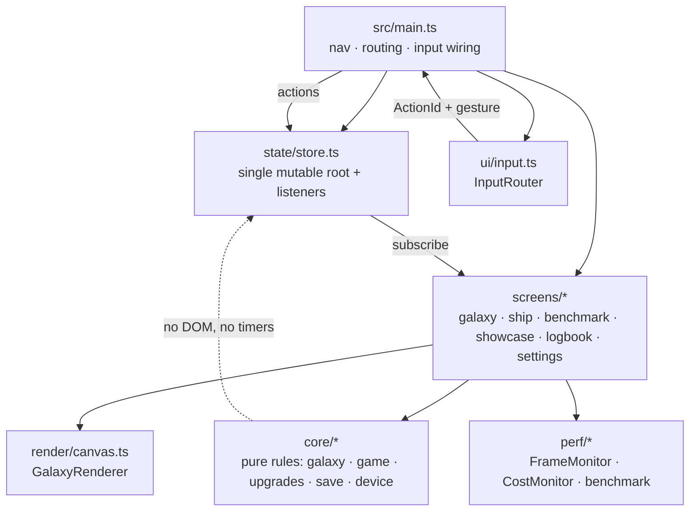
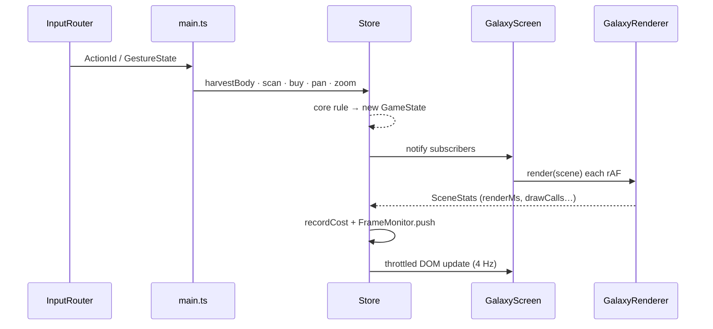

# Architecture

## Shape



Two rules keep this tractable:

1. **`src/core/*` never touches the DOM, `window`, or timers.** Every rule is
   pure: state in, new state out. That is why 73 unit tests run in Node in under
   a second and exercise the exact functions the UI calls.
2. **One render loop.** Only the galaxy screen paints the map, from one
   `requestAnimationFrame` loop. DOM is updated on a 4 Hz budget and only when a
   signature (selected body, visible ids, risk-log length, resources) changes.

## Layers

| Layer | Files | Responsibility |
|---|---|---|
| Domain | `core/types.ts`, `core/rng.ts`, `core/galaxy.ts`, `core/upgrades.ts`, `core/game.ts` | Deterministic generation, economy, rules |
| Adaptation | `core/device.ts` | Capabilities → layout spec → quality budget; hysteresis controller |
| Persistence | `core/save.ts` | Envelope encode/validate, localStorage, IndexedDB mirror |
| State | `state/store.ts` | Root state, actions, throttled frames, save scheduling |
| Render | `render/canvas.ts` | Starfield, bodies, selection rings, particles, vignette |
| Perf | `perf/monitor.ts`, `perf/benchmark.ts` | Frame statistics, cost accounting, scoring, report |
| UI | `ui/dom.ts`, `ui/focus.ts`, `ui/input.ts`, `ui/widgets.ts` | Element helper, focus ring, input router, overlay/modal/toasts/menu |
| Screens | `screens/*` | Page composition and in-place updates |

## Data flow



## The render loop

`GalaxyScreen.onEnter()` starts the loop; `onExit()` cancels it, so no background
screen burns frames. Per frame:

1. `store.frame(timestamp, dt)` — feed `FrameMonitor`, run adaptive quality,
   apply idle income (1 Hz), roll risk events (seeded by galaxy seed × tick),
   update peak/average FPS.
2. Build a `SceneInput` snapshot (galaxy, camera, selection, particles, budget,
   palette, time).
3. `renderer.render(scene)` — one `resize` check, starfield, reach ring, bodies,
   rings, particles, vignette. Returns `{entities, particles, drawCalls, renderMs}`.
4. `store.recordCost(...)` — rolling averages for the overlay.
5. Throttled DOM refresh.

Theme colours are read from CSS custom properties via `getComputedStyle`, so
light/dark/OLED/e-ink need no canvas code changes and no duplicated colour table.

## Determinism

- `core/rng.ts` is mulberry32. Galaxy layout, body kinds, deposits, particle
  velocities, and risk rolls all derive from explicit seeds.
- Risk rolls use `galaxy.seed ^ (tick * 2654435761)`, so the same save replays
  the same events. Tests assert this (`risk rolls are deterministic per seed`).
- The benchmark uses fixed scene sizes with a fixed generated distribution, so
  differences between runs reflect the machine, not the input.

There is no lookup table of expected FPS anywhere in the repo. If you delete the
renderer, the benchmark reports garbage, not a cached score.

## Layout and capability model

`detectCapabilities()` reads viewport, DPR, `maxTouchPoints`, media queries
(`pointer: coarse`, `hover: hover`, `monochrome`, `update: slow`,
`prefers-reduced-motion`), `hardwareConcurrency` and `deviceMemory`.

`resolveLayout()` turns that into one of `handheld`, `tablet`, `desktop`, `eink`
— unless the user pinned a profile in Settings, which wins unconditionally so a
tablet can be tested on a desktop. No device model name is ever consulted.

`qualityBudget(level, eink)` produces concrete numbers (monochrome, particles,
starfield, trails, glow, shadows, rendered-body cap, target frame time, motion
scale). `Store.einkActive()` treats a pinned `eink` layout as e-ink just like an
OS `monochrome` hint, and the budget is rebuilt whenever layout, quality or the
particle switch changes.
`AdaptiveQuality` demotes after 45 consecutive frames slower than 40 ms and
promotes only after 240 consecutive frames faster than 19 ms, which prevents the
classic flap where a stutter triggers a downgrade, the downgrade runs fast, and
it immediately upgrades again.

## Input architecture

`InputRouter` listens once on `document.body` and converts:

- keydown/keyup → `ActionId` via `KEY_ACTIONS`, de-duplicated by `event.code` so
  OS key repeat cannot fire multiple confirmations;
- pointer events → tap / long-press (480 ms) / drag / pinch (two pointers) /
  hover / wheel / context menu;
- `navigator.getGamepads()` polling → button edges + analog axis edges.

Pointer gestures only **start** inside the map stage (`setGestureHost`). Without
that, tapping a sidebar button would register as a map tap, mutate the store, and
rebuild the DOM before the button's `click` could fire — a bug this project hit
and now has an interaction test against.

`InputRouter.injectGamepadButton()` swaps `navigator.getGamepads` for the duration
of one poll, so the probe travels the identical polling path a real pad uses
instead of calling `onAction` directly.

## Persistence

```
GameState + Settings
      └─ encodeSave() → { schema, version, savedAt, state, settings }
             ├─ localStorage["pocket-galaxy.save.v3"]   (synchronous, authoritative)
             └─ IndexedDB["pocket-galaxy"/"saves"]["latest"]  (async mirror, throttled 1.2 s)
```

`decodeSave()` validates schema, version ceiling, galaxy array, non-negative
finite resources, and hull in `0..100`. The store keeps an immutable
`sessionOrigin` (`new game` / `loaded` / `mirror`) alongside the mutable save
status, because autosave overwrites the status within a second and a restored
session would otherwise be indistinguishable from a fresh one. A corrupt envelope returns `null` and the
app boots a fresh game rather than silently repairing or half-loading. Quota
exhaustion drops the history mirror and retries once, then reports `quota`.

## Build and cache busting

`scripts/build.mjs` bundles to `dist/app.js`, hashes `app.js + app.css`, bumps
`asset-version.json`, and rewrites `index.html` `?v=N`. Any JS or CSS change
therefore produces a new version string; the acceptance test asserts the JS and
CSS are requested with the same current `?v=`.

## Deliberate omissions

- No framework/runtime dependency. Sibling PJOS apps use React + Vite; this one is
  a PocketJS-adjacent showcase where the canvas loop is the point, and vanilla
  keeps the paid-per-frame cost to layout + paint only.
- No router, no i18n layer, no service worker, no analytics.
- No fake data paths: `readMemory()` returns `null` and the overlay prints `n/a`
  when the browser has no heap API.
