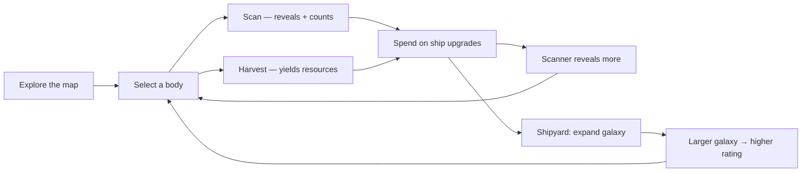

# Gameplay

## The loop



A run is: pick a body the scanner can reach, harvest it for Energy/Mineral/
Science, spend those on ship systems, and when the current galaxy stops paying
out, expand to a bigger scale. The rating rises with coverage, upgrades and
scanner level.

## Resources

| Resource | Source bodies | Used for |
|---|---|---|
| Energy | star (1.0), comet (0.5), blackhole (0.5), planet (0.4) | Engine, Cargo, Speed, shield |
| Mineral | asteroid (1.0), planet (0.6), ruins (0.4) | Cargo, Shield, Mining, hull repair |
| Science | nebula (1.0), ruins (0.8), blackhole (0.8), comet (0.5) | Scanner, Speed, Mining |

Yields are proportional shares of a body's weight table, multiplied by
`1 + 0.45 × miningLevel`, then clamped per kind by the cargo cap
(`200 + 160 × cargoLevel`). Overflow is discarded, not banked — the cap is a real
constraint, and it is what makes Cargo worth buying.

Idle income: every **discovered star** trickles 0.5 energy/second, capped by cargo.
It is small on purpose — the loop stays active, the idle layer only softens it.

## Bodies

| Kind | Deposit range | Yield profile | Note |
|---|---|---|---|
| Star | 60–120 | Energy | Drives idle income once discovered |
| Planet | 40–90 | Energy + Mineral | Counts toward "visited planets" |
| Asteroid | 25–60 | Mineral | Dense, cheap, most common |
| Comet | 30–70 | Energy + Science | — |
| Black Hole | 90–180 | Energy + Science | Rarest, richest, outer arms |
| Nebula | 35–80 | Science | Largest visual body |
| Ancient Ruins | 45–100 | Science + Mineral | Core-skewed |

Generation places bodies on three spiral arms with jitter, using `progress^0.62`
so the core is dense. Kind weights shift outward: asteroids and black holes get
more common in the outer arms, stars and ruins less common. Everything derives
from the seed.

## Scanner range

`scannerReach = min(1.6, galaxy.revealRadius + 0.09 × scannerLevel)`

`revealRadius` per scale: small 0.34, medium 0.48, large 0.62, huge 0.76,
massive 0.90. Bodies inside the reach (plus a size tolerance) are selectable;
bodies outside render as faint dust so the map still reads as a galaxy. A body
you have scanned stays visible regardless of range.

## Galaxy scales

| Scale | Bodies | revealRadius |
|---|---|---|
| Small | 90 | 0.34 |
| Medium | 260 | 0.48 |
| Large | 620 | 0.62 |
| Huge | 1200 | 0.76 |
| Massive | 2400 | 0.90 |

Expansion regenerates the map from a new seed: **resources, hull and all upgrade
levels carry over; discoveries reset.** That is the "bigger galaxy" step, and it
is confirmed through a self-drawn modal.

## Ship upgrades

| Upgrade | Base cost | Growth | Max | Effect |
|---|---|---|---|---|
| Engine | 40E / 30M | ×1.55 | 10 | Reach +9% per level |
| Scanner | 30E / 20M / 20S | ×1.60 | 10 | Scan radius +0.09 per level |
| Shield | 25E / 45M / 10S | ×1.50 | 10 | Damage −7% per level (floor 30% taken) |
| Cargo | 35E / 35M / 5S | ×1.45 | 10 | Cap 200 + 160×level |
| Mining | 20E / 50M / 15S | ×1.58 | 10 | Yield ×(1 + 0.45×level) |
| Speed | 45E / 25M / 25S | ×1.52 | 10 | Cooldown 900 → 280 ms |

`upgradeCost(id, level) = ceil(base × growth^level)` per resource. A purchase
either deducts exactly the quoted cost and raises the level by one, or changes
nothing (`insufficient` / `max-level`). Both refusals are unit-tested.

## Risk events

Rolled once per second at 16% probability, seeded by `galaxySeed ^ (tick ×
2654435761)`:

| Event | Hull | Resources |
|---|---|---|
| Asteroid Storm | −6…−18 | +14 mineral |
| Radiation Zone | −4…−12 | +10 science |
| Pirate Signal | −3…−10 | −18 energy, −10 mineral |
| Space Anomaly | 0…−4 | +22 energy, +16 science |

Hull damage is multiplied by `max(0.3, 1 − 0.07 × shieldLevel)`. There is no
combat: risk is a resource/hull pressure valve that makes Shield and repair
meaningful, and every event is written to the risk log shown on the galaxy screen.

Hull repair costs `ceil((100 − hull) × 0.8)` mineral, from the Shipyard.

## Rating

```
score = min(100, round(
    coverage        × 56      // discovered / bodies, 0..1
  + min(24, upgradeSum × 1.6)
  + scannerLevel   × 3
  + scaleBonus                // small 0 · medium 8 · large 16 · huge 24 · massive 32
))
```

Labels: `E < 20 ≤ D < 38 ≤ C < 54 ≤ B < 68 ≤ A < 80 ≤ A+ < 92 ≤ S`.

## Achievements

| Id | Title | Condition |
|---|---|---|
| explorer | Explorer | Discover 50 bodies |
| scientist | Scientist | Collect 1,000 science |
| builder | Galaxy Builder | A galaxy with ≥ 2,000 bodies |
| perf | Performance Master | Observed peak ≥ 58 FPS |
| lastlight | Last Light | Alive at ≤ 20 hull |
| keeper | Galaxy Keeper | Every system ≥ level 1 |

Achievements are evaluated from current state on every render — no persistent
"unlocked" flag can drift from reality.

## Session statistics

Play time, travel distance, discoveries, scans, harvest count, resources and
science collected, visited planets, upgrades bought, galaxy size, peak FPS,
average FPS, achievements. Shown in Logbook; the same `Stats` object is saved.

## Pause, save, restart

- **Pause**: START / P or the Settings button. Halts idle income, risk rolls and
  particle motion; the map keeps rendering so the overlay still measures.
- **Save**: automatic (debounced 600 ms after any change, plus 1 Hz idle income
  and any risk event), manual via Settings → Save now. localStorage is
  authoritative; IndexedDB mirrors 1.2 s later.
- **Restart**: Settings → Restart, confirmed through a self-drawn modal, wipes
  local storage and generates a fresh medium galaxy from a new seed.
