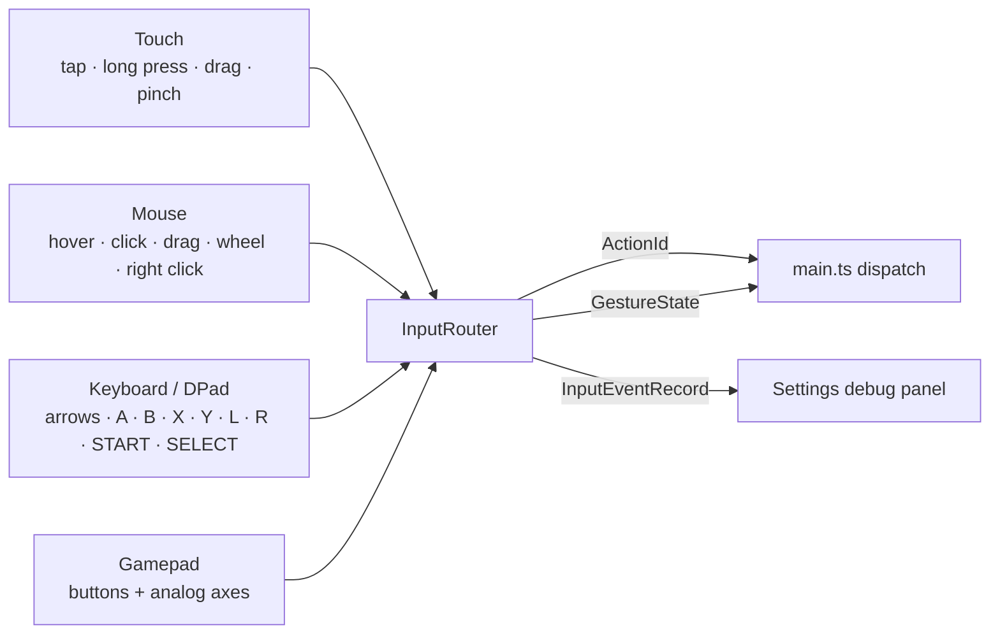

# Inputs

Four input sources, one semantic action enum. Gameplay code never sees a
keyboard key, a pointer event, or a gamepad index — only `ActionId`.



## Actions

| ActionId | Keyboard | Gamepad (default) | Meaning |
|---|---|---|---|
| `up` `down` `left` `right` | Arrow keys | D-pad / left stick | Pan the map or move the focus ring |
| `confirm` | Enter, Space | A / Cross (0) | Harvest, activate focused control |
| `back` | Escape, Backspace | B / Circle (1) | Deselect, close menu/modal, return to galaxy |
| `scan` | Z | X / Square (2) | Scan the selected body |
| `details` | X | Y / Triangle (3) | Detail modal for the selected body |
| `zoomOut` `zoomIn` | `-` `=` / `+` | L1 (4) / R1 (5), right stick | Zoom the map |
| `navPrev` `navNext` | `[` `]` | L2 (6) / R2 (7) | Previous / next page |
| `perf` | F | SELECT (8) | Toggle the performance overlay |
| `pause` | P | START (9) | Pause / resume |

The map/HUD also supports: double-tap or double-click to zoom 1.5×, right click
or long press for the context menu, hover for a highlight ring.

## Touch

| Gesture | Implementation | Result |
|---|---|---|
| Tap | pointerdown→pointerup, travel ≤ 10 px, < 480 ms | Select the body under the point |
| Double tap | second tap within 320 ms | Zoom ×1.5 |
| Long press | 480 ms hold without >6 px travel | Context menu at the press point |
| Drag | single pointer moving > 0.5 px | Pan (camera delta from pointer delta) |
| Pinch | two pointers, distance ratio | Multiply zoom by the ratio |

Pinch uses the ratio between consecutive two-pointer distances, so it is
proportional rather than fixed-step. Pointer capture is set on pointerdown so a
drag that leaves the canvas keeps resolving.

## Mouse

Hover → highlight ring + `mouse:hover` log. Click → select. Drag → pan. Wheel →
zoom ×1.12 per notch (direction-sensitive). Right click → app-drawn context menu
(`contextmenu` is prevented; the pointerup path opens the menu too, because some
embedded engines never synthesize `contextmenu`).

## DPad / keyboard

Two behaviors, chosen by context:

- **On the map** (galaxy screen with the stage focused): arrows pan, `=`/`-` zoom,
  confirm harvests the selection or picks the first visible body.
- **Off the map**: arrows move a real focus ring over `[data-focusable]` elements
  in DOM order (Tab order == visual order), confirm clicks the focused element,
  back returns to the galaxy.

Key repeat is suppressed with `event.code` de-duplication, so holding a direction
cannot fire twenty harvests.

### Focus ring

`src/ui/focus.ts`:

- collects visible, enabled `[data-focusable]` elements inside the active screen;
- wraps at the ends;
- applies `.focused` (2 px outline + soft ring; 3 px, no glow in e-ink);
- calls `element.focus()` so native scroll-into-view works and `.click()` fires
  the same handler a pointer would;
- remembers the last focused element across scope changes.

Every key screen is fully operable this way: Shipyard (upgrades), Benchmark
(run/copy), Showcase (ten demo buttons), Logbook, Settings (segments, switches,
rebind buttons, save controls). The acceptance test buys an upgrade with nothing
but `ArrowDown` + `Enter`.

## Gamepad

`pollGamepad()` runs every animation frame (single rAF chain started at boot) and:

1. Reads `navigator.getGamepads()`.
2. Builds a pressed-button bitmask, computes the rising edge against the previous
   mask, and dispatches only edges (`onButtonPress` semantics, no repeat).
3. Converts left-stick crossing of the 0.55 deadzone into one `up/down/left/right`
   per crossing, so a held stick does not spam actions.
4. Reads the right stick (axes 2/3) as a zoom throttle: past the deadzone it
   emits one `zoomIn`/`zoomOut` every 120 ms while held, which reads as
   continuous zoom without flooding the action queue.
4. Reports `{connected, id, buttons}` to the store, which the Settings panel shows.

When the Settings panel is listening for a rebind, `onGamepadButton` returns
`true` for the next pressed button: the press is consumed by the binding UI
instead of being dispatched as an action. The new map is written to settings
immediately and applied live.

### Verifying a gamepad without hardware

Settings → **Inject gamepad button** calls `InputRouter.injectGamepadButton(0)`,
which temporarily replaces `navigator.getGamepads` with a synthetic standard pad,
polls once (press), replaces it with a released pad, polls again (release), then
restores the original. The press therefore travels the *same* code path a real
controller uses — the probe cannot pass unless polling, edge detection, mapping
and dispatch all work.

The interaction suite injects D-pad Right (15), L1/R1, A (0), SELECT (8), R2 (7),
and right-stick deflections through `injectGamepadStick`, asserting the resulting
camera/zoom/harvest/rebind state.

## Debug panel

Settings → **Input probe** shows the last 14 events, newest first:

```
[gamepad] up — D-Pad Up on "Pocket Galaxy Probe Pad (standard)"
[touch]   tap — tap @218,401
[mouse]   zoom — wheel -240
[keyboard] confirm — Enter down
```

Sources are colour-coded (`--accent` for actions, `--accent-3` for the source
tag). The log is capped at 60 entries and updates through a dedicated listener
that touches only the log element — a full screen rebuild here used to destroy
the button under the pointer mid-click (now covered by a regression test).

Use it for device sign-off: press every physical button on a handheld and confirm
the expected source/action pairs appear. That is the fastest way to prove an
evdev→PocketJS mapping is correct.

## Why gesture start is scoped

Pointer gestures only begin inside the map stage (`InputRouter.setGestureHost`
is re-pointed on every navigation). Without that scoping, a tap on a sidebar
button was also a "map tap": it mutated the store, rebuilt the screen, and the
button's `click` never fired. That bug shipped once during development; the
regression test is `tests/interaction/inputs.mjs` (mouse click on Settings →
rebind) plus the gameplay suite's button clicks.
